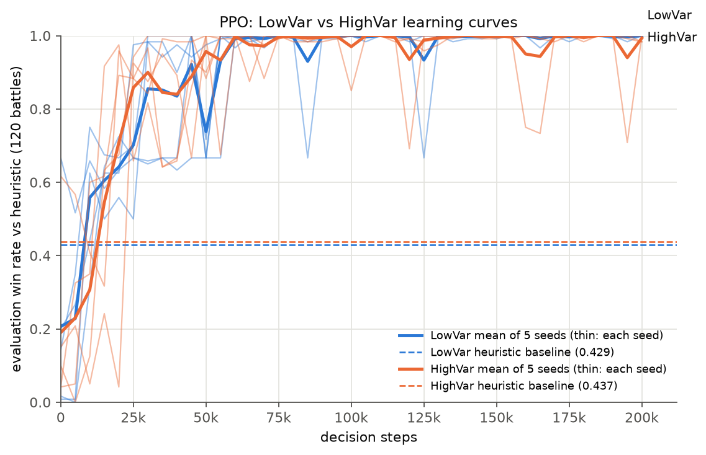

# Outcome variance and RL learning in Pokémon battles

RL midsem project, Monsoon 2026. We train a PPO agent to play 4v4 Pokémon singles battles on Pokémon Showdown,
and test whether making a team's moves **riskier** (less accurate but stronger) changes how fast and how
reliably the agent learns.

**Result in one line:** PPO learns to beat the heuristic opponent almost perfectly (99.7–100% win rate, against
a ~43% heuristic baseline) within about 50–75k decision steps. The riskier team made **no measurable
difference** to learning speed or final strength.



## Contents

- [The question](#the-question)
- [The experiment](#the-experiment)
- [Results](#results)
- [Repository layout](#repository-layout)
- [Setup](#setup)
- [Running things](#running-things)
- [Further reading](#further-reading)

## The question

Every Pokémon battle is random: moves miss, damage rolls vary, secondary effects trigger. We want to know
whether **outcome variance** affects how an RL algorithm learns. This is a first step toward comparing
playing styles in doubles VGC in the final project.

**The manipulation.** One team exists in two versions. Everything is identical (species, items, abilities,
EVs, IVs, natures and all other moves) except that four accurate moves are swapped for inaccurate,
higher-power ones:

| Pokémon | LowVar (`Teams/lowvar.txt`) | HighVar (`Teams/highvar.txt`) |
|---|---|---|
| Moltres | Flamethrower 90 BP / 100% | Fire Blast 110 BP / 85% |
| Moltres | Air Slash 75 BP / 95% | Hurricane 110 BP / 70% |
| Primarina | Surf 90 BP / 100% | Hydro Pump 110 BP / 80% |
| Primarina | Ice Beam 90 BP / 100% | Blizzard 110 BP / 70% |

The full team is Great Tusk, Moltres, Primarina and Kingambit.

**Research questions:**

- **RQ1:** Does the HighVar team need more environment steps to reach the same performance, and do runs
  disagree more across seeds?
- **RQ3 (secondary):** Does final strength differ?

RQ2 compared PPO with DQN. DQN is implemented in `src/DQN/`, but this report presents the PPO results only.

## The experiment

| | |
|---|---|
| Game | Gen 9 OU singles with Terastallization off (custom format `gen9ounotera`), 4 Pokémon per side, fixed lead order, run on a local Pokémon Showdown server |
| Opponents | Three teams, all piloted by poke-env's `SimpleHeuristicsPlayer`. A: Glimmora, Dragapult, Dragonite, Iron Valiant. B: Landorus-Therian, Gholdengo, Zamazenta, Kyurem. C: Corviknight, Clefable, Gliscor, Raging Bolt |
| What the agent sees | Open team sheets: the full sets of both teams, plus the battle state (HP, status, boosts, field and so on). A 763-number observation vector (`src/encoder.py`) |
| Actions | 26 discrete actions (4 moves, switches), with illegal actions masked |
| Reward | +1 for a win, −1 for a loss, plus potential-based shaping on remaining HP and fainted Pokémon. Shaping with γ = 0.99 and Φ(terminal) = 0 does not change which policy is optimal |
| Algorithm | MaskablePPO (sb3-contrib): lr 3e-4, n_steps 2048, batch 128, 10 epochs, clip 0.2, entropy 0.01, two hidden layers of 256 |
| Budget | 200,000 decision steps per run (≈ 15,300 training battles) |
| Runs | 2 teams × 5 seeds = 10 runs |
| Evaluation | Every 5,000 steps: 120 greedy battles vs the heuristic, 40 against each opponent team. At the end: 1,020 battles vs the heuristic, and 204 each vs a random player and a max-base-power player |
| Baseline | The same heuristic piloting our team: 0.429 win rate (LowVar) and 0.437 (HighVar) over 1,500 battles |

The full specification is `Pokemon_RL_PPO_Spec_4v4.md`. Implementation decisions and the poke-env details we
checked are in `NOTES.md`.

## Results

The full write-up, with every table and the caveats, is in **[`results.md`](results.md)**.

| | LowVar | HighVar | p |
|---|---|---|---|
| Area under the learning curve (AUC), 0–200k steps | 0.907 ± 0.022 | 0.906 ± 0.020 | 0.91 |
| AUC, 0–50k steps (the learning phase) | 0.667 ± 0.090 | 0.670 ± 0.075 | 0.96 |
| Steps until win rate holds ≥ 0.95 | 50k ± 12k | 52k ± 20k | 0.95 |
| Final win rate vs heuristic (1,020 battles) | 0.9998 | 0.9994 | ceiling |
| Final win rate vs max-base-power player | 0.926 | 0.918 | 0.86 |
| Evaluation dips below 0.95 after 60k steps, per run | 0.4 | 1.4 | 0.14 |

Values are the mean ± std over 5 seeds. The p-values come from exact two-sided permutation tests.

**Findings:**

1. **PPO beats the heuristic almost every time, on both teams.** Win rate goes from ~20% untrained to
   99.7–100%.
2. **The opponents are learned in the same order on every run: A, then B, then C.** The plateau at 2/3 in
   the learning curve is the stage where A and B are solved and C is not yet.
3. **No difference between LowVar and HighVar** in learning speed, disagreement between seeds or final
   strength (RQ1 and RQ3).
4. **A possible stability effect, not significant.** HighVar runs more often have brief collapses after
   converging, where one opponent's matchup drops to near 0 and then recovers. With 5 seeds it is only a hint.
5. **The policies are specialised to the heuristic.** They are weaker against opponents they never trained
   against, especially the max-base-power player with team A.

**Why the result is probably null.** The heuristic opponent is deterministic and exploitable. In the battles
we watched, PPO found a narrow winning line (sacrifice the lead, then sweep with Kingambit after Swords Dance)
that uses none of the swapped moves. If the risky moves are never used, their accuracy cannot affect learning.
Even the heuristic baseline, which misses swap moves 23% of the time on HighVar against 2% on LowVar, has the
same win rate with both teams. Measuring swap-move usage over many battles of the trained agents is the
obvious next step.

### Figures

| File | What it shows |
|---|---|
| `figures/curves_ppo.png` | Evaluation win rate vs decision steps: mean of 5 seeds per team, each seed, and the heuristic baselines |
| `figures/interaction_auc.png` | AUC per seed, LowVar vs HighVar |
| `figures/ep_len.png` | Training battle length over time for each run |
| `runs/ppo_<team>_s<seed>/learning_curve.png` | One detailed plot per run, with Wilson 95% intervals |
| `runs/pilot_2M/` | The 2M-step pilot (3 runs), which showed convergence by 30–80k steps and set the 200k budget |

`figures/threshold_steps.png` and `figures/interaction_lift.png` also exist. The threshold metric
(baseline + 0.10) is crossed within 30k steps by every run, and the lift only shows the 100% ceiling, so
neither is informative here.

The tables behind the figures:

- `figures/summary.csv`: every metric for every run.
- `figures/contrasts.csv`: the LowVar − HighVar differences.
- `figures/runs_index.csv`: each run's status and commit.

## Repository layout

```
Pokemon_RL_PPO_Spec_4v4.md   the experiment specification
NOTES.md                     implementation decisions, poke-env findings, throughput, budget decision
results.md                   full PPO results
RL_Midsem_Presentation.pdf   midsem presentation
docs/                        project proposal, DQN design notes (dqn.tex)

Teams/                       lowvar.txt, highvar.txt (our team), opp_a/b/c.txt (opponents)
baselines_summary.csv        heuristic/random/max-base-power baselines per team and opponent
Baselines_Log - Battles.csv  one row per baseline battle

src/
  config.py                  every constant: format, seeds, budget, PPO settings, evaluation sizes
  teamsheet.py               parses team files into open team sheets
  check_teams.py             checks the two team versions differ only in the swapped moves
  teams.py                   opponent team rotation (random for training, stratified for evaluation)
  encoder.py                 battle state -> 763-number observation
  env.py                     poke-env environment: masks, shaped reward, fixed leads
  train_ppo.py               trains one PPO run
  callbacks.py               in-training evaluation every 5k steps, episode logging
  evaluate.py                stratified evaluation and the final evaluation
  recorder.py                writes run_config.json, eval.csv, train_episodes.csv, final_eval.csv, checkpoints
  metrics.py                 Wilson intervals, AUC, threshold steps, stability
  plotting.py                per-run learning_curve.png
  run_batch.py               runs the 10 runs, 3 at a time
  analyze.py                 aggregates runs into figures/ and validates the output format
  watch_battle.py            plays one battle with a trained agent and saves an animated replay
  baselines.py               scripted-pilot baseline battles
  summarize_baselines.py     baselines_summary.csv from the battle log
  bench_env.py               throughput benchmark
  DQN/                       DQN arm (partner's implementation, own README and tests)

tests/                       pytest suite (team checks, encoder, env, reward, pipeline, analysis)
runs/                        one folder per run: eval.csv, final_eval.csv, train_episodes.csv, plots
figures/                     aggregate figures and tables from analyze.py
pokemon-showdown/            Showdown server (git submodule)
```

Checkpoints (`runs/*/ckpt/`), TensorBoard logs and replays are not committed.

## Setup

Requires Node 22 (≥ 22.18) and Python 3.12 or newer. Run everything from the repository root.

**1. Showdown server, one-time setup:**
```bash
git submodule update --init pokemon-showdown
cd pokemon-showdown
npm ci
cp config/config-example.js config/config.js
cp ../showdown-custom-formats.ts config/custom-formats.ts   # adds the gen9ounotera format
npm run build
cd ..
```

**2. Python environment:**
```bash
python3 -m venv venv
source venv/bin/activate
pip install -r requirements.txt
```

**3. Each session, start the server and leave it running:**
```bash
cd pokemon-showdown && node pokemon-showdown start --no-security
```
It listens on `localhost:8000`.

**4. Check everything works:**
```bash
python src/check_teams.py
python -m pytest -q              # 78 tests; the live ones are skipped if the server is down
```

See `usage.txt` for the same steps with nvm.

## Running things

**Train one run:**
```bash
python src/train_ppo.py --team highvar --seed 0     # 200k steps, ~25 min (measured with 3 in parallel)
```

**Train all 10 runs** (≈ 1.6 h at 3 in parallel; refuses to start from uncommitted code):
```bash
python src/run_batch.py --algo ppo --parallel 3
python src/run_batch.py --status
```

**Aggregate into figures and tables.** `runs/` also holds the DQN runs, so point the analysis at the PPO
runs only:
```bash
mkdir -p /tmp/ppo_runs && ln -sf "$PWD"/runs/ppo_{lowvar,highvar}_s[0-4] /tmp/ppo_runs/
python src/analyze.py --runs-dir /tmp/ppo_runs --out figures
```

**Watch a trained agent play.** This plays one battle against the heuristic and prints a play-by-play with
the agent's action probabilities. The animated replay is saved to `runs/replays/`; open it in a browser
(you need to be online, because the replay viewer loads from Showdown's website):
```bash
python src/watch_battle.py --run ppo_lowvar_s0                  # waits for Enter, then plays slowly
python src/watch_battle.py --run ppo_highvar_s0 --opp C --no-wait --delay 0
xdg-open "$(ls -t runs/replays/*.html | head -1)"
```
You can also watch live: open http://localhost:8000 and `/join` the battle tag the script prints. This
depends on Showdown's own website being reachable.

**Re-run the baselines:**
```bash
python src/baselines.py            # 500 battles per team × pilot × opponent block
python src/summarize_baselines.py  # -> baselines_summary.csv
```

## Further reading

- [`results.md`](results.md): all results, per-opponent analysis, stability, limitations.
- [`Pokemon_RL_PPO_Spec_4v4.md`](Pokemon_RL_PPO_Spec_4v4.md): MDP, reward, metrics and verification tests.
- [`NOTES.md`](NOTES.md): poke-env behaviour we had to work around, throughput, and why the budget is 200k.
- [`RL_Midsem_Presentation.pdf`](RL_Midsem_Presentation.pdf): the midsem presentation.
- [`src/DQN/README.md`](src/DQN/README.md): the DQN implementation.
